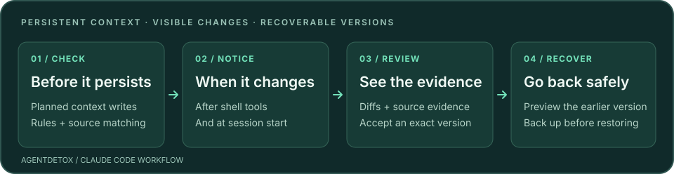

<div align="center">


# AgentDetox

### Check what your agent saves. See what changed. Recover what was there.

Protection for the memory, instructions, skills and config your coding agent trusts across sessions.

[](https://pypi.org/project/agentdetox/)
[](https://github.com/chriswu727/agentdetox/actions/workflows/ci.yml)
[](https://pypi.org/project/agentdetox/)
[](https://github.com/chriswu727/agentdetox/blob/main/LICENSE)

[Quick start](#quick-start) · [How it works](#how-it-works) · [Evidence](#evidence-and-limits) · [Documentation](https://github.com/chriswu727/agentdetox/blob/main/docs/README.md)

**English (primary)** · [简体中文](https://github.com/chriswu727/agentdetox/blob/main/README.zh-CN.md)

</div>

---

A poisoned page can become tomorrow's memory. An install script can change `CLAUDE.md` while
your agent is busy elsewhere. AgentDetox checks writes to persistent context, records changes
with source evidence, and lets you review and restore earlier versions.

**0.4.0 is published** on [PyPI](https://pypi.org/project/agentdetox/0.4.0/) and
[GitHub](https://github.com/chriswu727/agentdetox/releases/tag/v0.4.0).
The project is in **preview**: Claude Code is supported; Codex and Cursor hooks are experimental;
OpenClaw has tamper detection only. Developed on macOS; Windows has CI coverage, without
validation through daily use on a real machine.

<p align="center">
<picture>
<source media="(max-width: 600px)" srcset="https://raw.githubusercontent.com/chriswu727/agentdetox/main/assets/workflow-mobile.svg">

</picture>
</p>

| Prevent risky writes | Notice context changes | Review and recover |
|---|---|---|
| Deny rule-matched high-risk instructions; ask about copied memory and changes to guardrails. | Compare context after shell tools and at session start, including changes made outside edit tools. | Inspect diffs and source evidence, accept an exact version, or preview recovery with a backup. |

## Quick start

Requires **Python 3.11+**. Install with [uv](https://docs.astral.sh/uv/) or `pipx`:

```bash
uv tool install agentdetox
agentdetox demo
```

The demo uses real hook handlers in a temporary folder: a planted write is denied, shell tampering
is noticed, and the file is restored. It makes **no model calls** and consumes no agent subscription usage.

Connect Claude Code using **one** of these routes:

<details open>
<summary><b>Claude Code plugin</b></summary>

Run in your terminal:

```bash
claude plugin marketplace add chriswu727/agentdetox
claude plugin install agentdetox@agentdetox
```

The plugin uses your installed `agentdetox`. Without it, the plugin needs `uvx` to fetch and run
its pinned release from PyPI. Installing the CLI above also gives you review and recovery commands.

</details>

<details>
<summary><b>Direct hooks in Claude Code settings</b></summary>

```bash
agentdetox install claude-code --apply
```

This backs up and updates your Claude Code settings. AgentDetox follows `CLAUDE_CONFIG_DIR`.
Use this route as an alternative to the plugin.

</details>

Restart Claude Code, then check the installation:

```bash
agentdetox doctor
agentdetox status
```

`doctor` reports missing, outdated or duplicate hooks. The first session scans existing context
before recording recovery checkpoints. [Installation, upgrades and removal →](https://github.com/chriswu727/agentdetox/blob/main/docs/user-guide.md#install)

## How it works

1. **Before a write:** check planned Write/Edit content and recognized shell writes. High-risk
   rule matches are denied; flagged text you supplied yourself asks instead, except hidden text. Changes to hooks,
   MCP servers, permissions and other guardrails need approval.
2. **After a write or shell tool:** retain versions and source evidence. Shell completion or
   failure triggers a scoped comparison and a review notice for changed context. The interval
   identifies when a change happened; it does not prove which process wrote it.
3. **At session start:** reconcile changes made outside the agent. Flagged content is reported
   until reviewed. Newly added runnable settings are mentioned once and stay in review.
4. **When you review:** inspect the diff and evidence, accept that exact version, dismiss a finding,
   or restore the version before a change. Recovery checks for newer edits and backs up the current file.

Watched Claude context includes `CLAUDE.md`, parent instructions, auto memory, rules, skills,
subagents, commands, output styles, hook scripts, settings and MCP config.
Rules cover English and Chinese. [Full coverage and behavior →](https://github.com/chriswu727/agentdetox/blob/main/docs/user-guide.md#what-it-does-in-claude-code)

### A review you can act on

```bash
agentdetox review --interactive           # browse this project's files in a terminal
agentdetox review --project . --since 7d  # recent project and auto-memory changes
agentdetox review C42                    # inspect a change id from your review list
agentdetox restore C42                   # preview the version before that change
agentdetox restore C42 --apply           # back up the current file and restore
```

`C42` is an example id; use the id shown by your own review list. Acceptance and dismissal never
grant permanent trust to a source. Recovery restores a **whole recorded version**, which can also
undo benign additions. For a newly added config entry, removing it with the tool that added it
is often preferable to restoring the whole settings file.
[Review, settings and recovery details →](https://github.com/chriswu727/agentdetox/blob/main/docs/user-guide.md#day-to-day)

<a id="what-it-does-not-catch"></a>

## Evidence and limits

AgentDetox is a layer of checks and recovery, **not a security boundary or a factual verifier**.
Paraphrased payloads and plausible false facts can pass. Arbitrary scripts and dynamically built
paths may escape pre-execution checks; scoped post-tool observation can detect persistent changes
afterwards. Detached background writes need later reconciliation. Hooks fail open on errors,
which remain visible in `doctor` and `status`. Code running as your user can alter the hooks or store.

| Evidence | What it establishes | Where to inspect it |
|---|---|---|
| Offline regression gallery | Authored prevention, monitoring and byte-exact recovery cases, with two explicit semantic misses. It is not a real-world accuracy estimate. | [Protocol and results](https://github.com/chriswu727/agentdetox/blob/main/bench/ACCURACY.md) |
| Real Claude Code lab, 2026-11-02 | 16 sessions across eight scenarios, both arms; all scenario assertions passed. Guardrail success and user-task completion are reported separately. | [Results](https://github.com/chriswu727/agentdetox/blob/main/lab/results/latest.md) |
| Reference latency, 2026-11-01 | 100 samples per case on one Mac, NLI off: Bash pre/post P95 **126.3 ms**, session start with 1,000 unchanged files **139.2 ms**. | [Method, raw data and budgets](https://github.com/chriswu727/agentdetox/blob/main/bench/HOOK_LATENCY.md) |

Source matching is evidence of copied text, not proof of malicious intent or human authorship.
An empty rescan does not certify a file as safe.
[Full limitations](https://github.com/chriswu727/agentdetox/blob/main/docs/user-guide.md#what-it-does-not-catch) ·
[Threat model](https://github.com/chriswu727/agentdetox/blob/main/SECURITY.md)

### Local processing, sensitive history

Hooks and checks make no network calls. There is no telemetry or account. Installation, the
plugin's `uvx` fallback and optional model downloads need network access. File copies and source
evidence stay in `~/.agentdetox`; copies of config files can contain secrets. Back up the entire
store, including `objects/`, and review retention before deleting history.
[Privacy and stored data →](https://github.com/chriswu727/agentdetox/blob/main/PRIVACY.md)

## More workflows

- **Other agents:** experimental Codex and Cursor hooks; OpenClaw tamper detection.
  [Integration matrix](https://github.com/chriswu727/agentdetox/blob/main/docs/user-guide.md#other-agents).
- **Contradiction checks:** optional local NLI, recorded in the background by default because of
  false positives. [Setup and limits](https://github.com/chriswu727/agentdetox/blob/main/docs/user-guide.md#contradiction-detection-experimental).
- **RAG knowledge bases:** `agentdetox scan` for hidden instructions and suspicious passage clusters;
  `trace` ranks leads behind a wrong answer. [Scanner guide](https://github.com/chriswu727/agentdetox/blob/main/docs/user-guide.md#also-scanning-a-rag-knowledge-base).

## Documentation and development

[Documentation index](https://github.com/chriswu727/agentdetox/blob/main/docs/README.md) ·
[User guide](https://github.com/chriswu727/agentdetox/blob/main/docs/user-guide.md) ·
[Changelog](https://github.com/chriswu727/agentdetox/blob/main/CHANGELOG.md) ·
[Roadmap](https://github.com/chriswu727/agentdetox/blob/main/ROADMAP.md) ·
[Contributing](https://github.com/chriswu727/agentdetox/blob/main/CONTRIBUTING.md)

```bash
./scripts/check.sh  # lint, type checks and tests
```

See [architecture](https://github.com/chriswu727/agentdetox/blob/main/docs/architecture.md) and
[design decisions](https://github.com/chriswu727/agentdetox/blob/main/docs/decisions.md) before
changing the hook or recovery path. The offline gallery makes no model calls; real-agent lab
runs require explicit authorization and a session cap.

Licensed under [Apache-2.0](https://github.com/chriswu727/agentdetox/blob/main/LICENSE).
